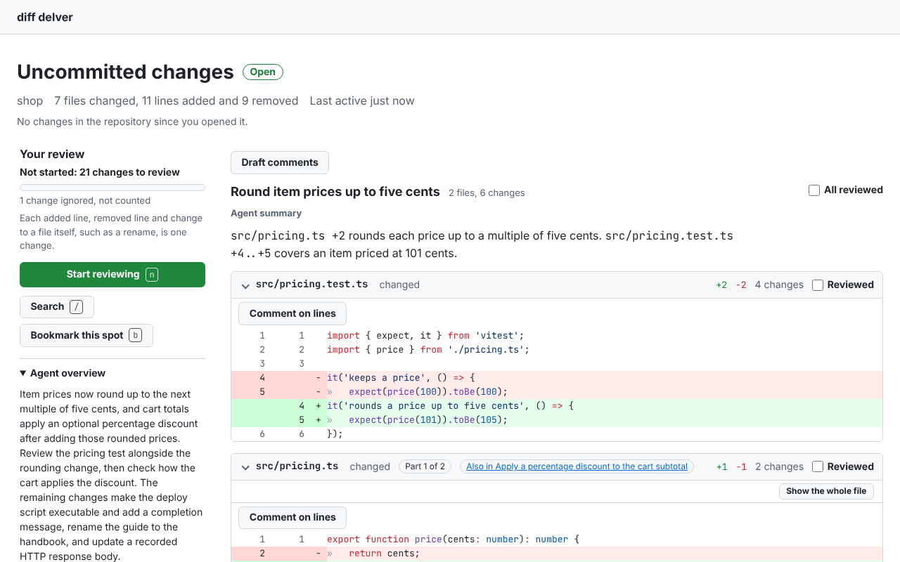
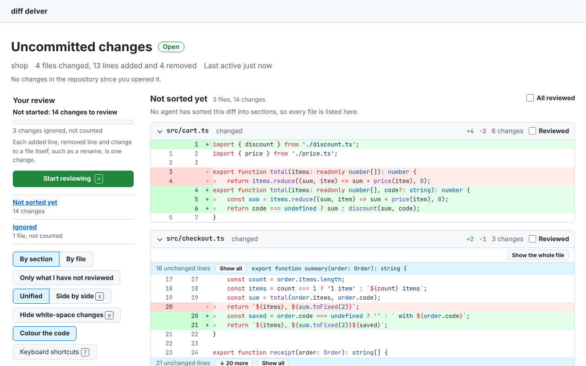
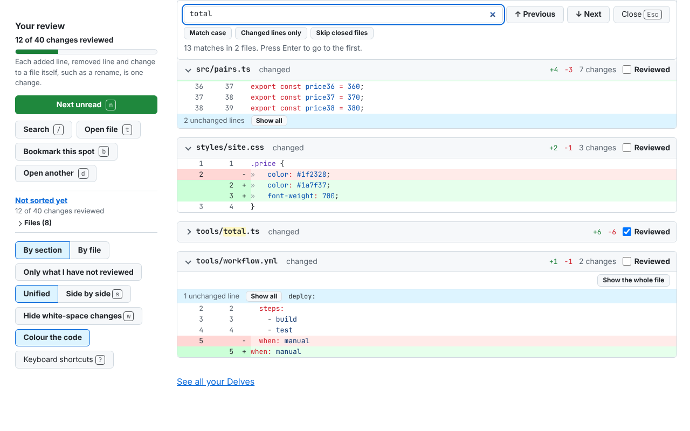
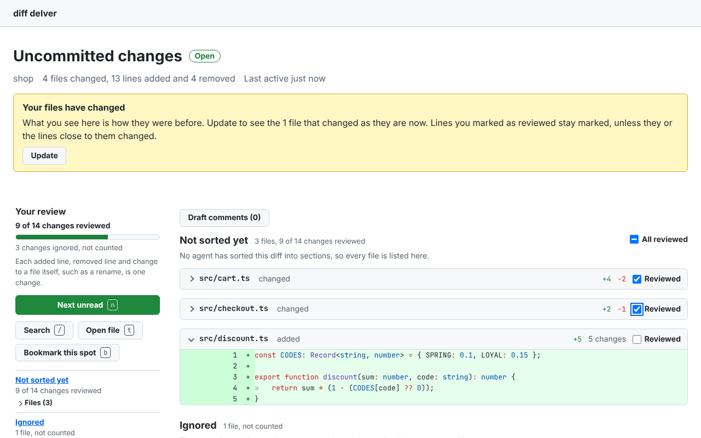
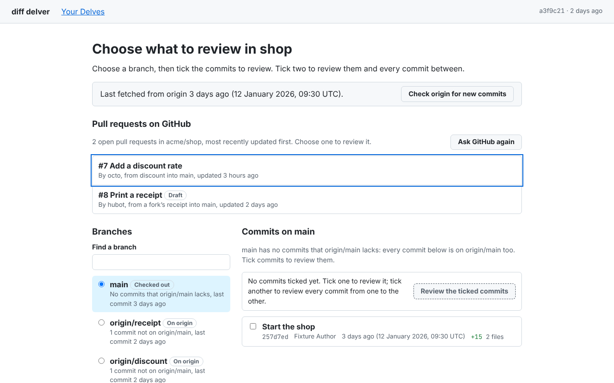

# diff delver

Review a Git diff in your browser, one logical section at a time. A coding agent
can sort your changes into sections. A **Delve** saves the diff, its sections and
your review progress on your machine.

<picture>
  <source media="(prefers-color-scheme: dark)" srcset="tests/journeys/screenshots/trial-shop-codex.01.sections-in-reading-order.dark.png">
  
</picture>

- **The diff is git's, not the agent's.** The agent only sorts the changes and names
  the sections. It cannot change what you are shown.
- **Every changed line is accounted for.** Each one is in a section, set aside as not
  needing review (a lockfile, say) with the reason, or listed as not sorted yet.
- **It keeps your place.** Tick what you have reviewed, and come back later. When the
  code changes, your ticks stay on the lines that did not.
- **It stays on your machine.** diff delver never writes to the repository you review.

> **Status: early build.** You can review a diff, write private draft comments,
> finish them as a review to paste to an agent, and have an agent sort changes into
> sections. It has been built and tested on Linux only. See
> [What works today](#what-works-today).

The pictures on this page are taken by the project's own tests, so they show the
current build.

## Use it

You need [Node](https://nodejs.org) 26 or newer, and git.

### Review your changes

In a git repository with changes, run:

```
npx https://github.com/lab273/diff-delver/releases/latest/download/diff-delver.tgz
```

npx asks whether to install diff delver. The release download is about 3 MB.
After installation, a Delve opens in your browser. It shows your uncommitted
changes. If you have none, it shows your branch compared with the main branch,
and if there is more than one likely choice, it asks.

<picture>
  <source media="(prefers-color-scheme: dark)" srcset="tests/journeys/screenshots/j0-first-run.02.the-uncommitted-changes.dark.png">
  
</picture>

On the page you can:

- **Read** each file's changes, in one column or side by side (`s`). Hide changes
  that only change white space (`w`), show more of the unchanged lines around a
  change, or show the whole file.
- **Tick** a file as reviewed (`r`), or a whole section at once. The bar on the left
  shows how far you have got.
- **Move on** to the next file you have not reviewed (`n`).
- **Comment** on a line by pressing its number, or `c` on it. Drag over the numbers,
  or hold Shift, to take several lines. Comments are private drafts on your machine,
  shown at their lines, and you can edit or delete them.
- **Finish and copy** your comments as a review: it goes on the clipboard, written
  for an agent, with the code each comment is on. Paste it to your agent, or ask your
  agent to act on your review in diff delver, and it reads the same review.
- **Search** the whole diff (`/`), including files that are closed.
- **Open file** (`t`) to find a filename and read it as of this Delve, before or after the changes.
- **See every key** with `?`. Everything works from the keyboard.

<picture>
  <source media="(prefers-color-scheme: dark)" srcset="tests/journeys/screenshots/j16-reading-and-finding.08.a-search-across-the-diff.dark.png">
  
</picture>

The examples below write `diff-delver` for short. Use the `npx` command above in its
place, or [install it](#upgrading) to get a real `diff-delver` command.

### Have a coding agent sort the diff

diff delver includes an MCP server that a coding agent can start. Add it to your
agent once. For Claude Code:

```
claude mcp add --scope user diff-delver -- npx --yes https://github.com/lab273/diff-delver/releases/latest/download/diff-delver.tgz mcp
```

For another agent, add an MCP server that runs the same command: everything after
the `--`.

A Delve that is not sorted yet shows these steps itself, with the commands for your
copy of diff delver and a sentence that names that Delve: press **Have an agent sort
this**.

Then start the agent in your repository and ask it, in your own words:

```
Sort my changes for review with diff delver.
```

The Delve opens in your browser and the sections appear as the agent makes them, in
the order it suggests you read them. The picture at the top of this page is a Delve
that Codex sorted in one of the project's recorded trials.

The agent sorts better when it has the project's skill, one file of advice on how to
sort a diff for a reviewer:
[`SKILL.md`](plugins/claude-code/skills/diff-delver/SKILL.md). Give it to your agent
as a file. For Claude Code, save it as `~/.claude/skills/diff-delver/SKILL.md`.

The MCP server uses the same data folder as the command. Add `--no-open` after `mcp`
to have the agent give you the page's address instead of opening a browser.

A link the agent gives you opens the Delve to read and tick. To write comments
there, press **Turn on comments in this browser** on the page: diff delver opens
the Delve in a tab of its own, and comments work in both.

If an older MCP shim stops connecting after an upgrade, update the agent's
`diff-delver mcp` command and restart its MCP server so it uses the new build.

### Keep reviewing as the code changes

When your files change, the page says so and offers **Update**. Running the command
again brings the Delve up to date too. Your sections and ticks are kept. A tick is taken off only where
the lines, or lines close to them, changed, and the page says why.

<picture>
  <source media="(prefers-color-scheme: dark)" srcset="tests/journeys/screenshots/j8-the-diff-changes-mid-review.01.the-files-have-changed.dark.png">
  
</picture>

**Your Delves**, at the top of every page, lists every Delve you have opened with how
far you got. Delete the ones you are done with there. On a Delve, **Open another**
(`d`) lists the others so you can go straight to one, and offers **Choose commits or
a branch** to open something new in the same repository without a terminal. The list
offers the same for each repository you have opened a Delve in.

### Choose what to review

| Command | Opens |
|---|---|
| `diff-delver` | The changes you most likely want: uncommitted changes, or your branch compared with the main branch |
| `diff-delver open working-tree` | Your uncommitted changes |
| `diff-delver open staged` | Only what you have staged |
| `diff-delver open HEAD` | One commit; a commit id such as `abc1234` works too |
| `diff-delver open main...feature-x` | One branch compared with another |
| `diff-delver open https://github.com/owner/repo/pull/123` | A pull request on GitHub, run in a clone of its repository |
| `diff-delver choose` | A page to choose from your branches, your commits and, for a repository on GitHub, its open pull requests |

The chooser landed after v0.0.1. To try it, run `npx github:lab273/diff-delver choose`
in your repository. Pick a branch, then tick two commits to review them and every
commit between, or review the whole branch at once. Each commit shows its size and
when it was made. You can see when your copy last fetched and check whether the
remote has new commits.

### Review a pull request

In a clone of a repository on GitHub, the choose page offers **Show open pull
requests**. Pick one, or run `diff-delver open` with its address, and it opens as a
Delve of what the pull request changes. diff delver downloads its commits into its
own folder, never into your clone. When new commits are pushed to it, the Delve
offers them as its next version, with your ticks kept, as it does for your own files.
Private repositories need a sign-in: diff delver uses the GitHub command's (`gh auth
login`), or else a token in `GITHUB_TOKEN`. It asks GitHub only when you open the
list, open a pull request or bring one up to date, and when a pull request's page
checks for new commits, at most once a minute, or once every five minutes when you
are not signed in, since GitHub then allows a computer few requests.

<picture>
  <source media="(prefers-color-scheme: dark)" srcset="tests/journeys/screenshots/j11-review-a-github-pr.02.the-open-pull-requests.dark.png">
  
</picture>

Other commands and options:

| | |
|---|---|
| `--no-open` | Print the page's address instead of opening a browser. The address works once. |
| `diff-delver stop` | Stop diff delver. It otherwise keeps running in the background, so pages stay open. Any copy can stop whichever one is running. |
| `diff-delver serve` | Run it in this terminal until Ctrl+C, instead of in the background. |
| `--data-directory <folder>` | Keep its data in this folder. The `DIFF_DELVER_DATA_DIRECTORY` environment variable does the same. |
| `--help`, `--version` | Show the help, or which version this is. |

diff delver keeps your Delves and ticks in one folder of its own,
`~/.local/share/diff-delver` on Linux. It is reached only from your own machine.
To take comment access away from every browser, run `diff-delver stop`, delete
`browser-access.json` in that folder, and start diff delver again.

### What works today

- Opening uncommitted changes, staged changes, a commit, or two branches compared,
  from a local git repository. Builds from `main` also let you choose commits or a
  branch from a page, and open a GitHub pull request, from a clone of its
  repository, and follow it as commits are pushed.
- Reading a diff: code coloured by language, one column or side by side, white-space
  changes hidden, unchanged lines opened, search, and a reading bookmark that
  survives reload in the same tab.
- Writing, editing and deleting private draft comments on either side of a diff,
  including unchanged lines, and an overall review in a bar at the foot of the page,
  and finishing them as a numbered review that is copied for an agent and that an
  agent can read through the MCP server.
- Changed images (PNG, JPEG, GIF, WebP and SVG) shown as pictures, with their sizes:
  side by side, with a slider, in onion skin, or with the pixels that changed marked.
  An SVG shows its text too.
- A diff's size with the lines of tests counted apart (`+40 −12 tests +20 −4`), and
  its binary files with their sizes in bytes.
- Ticking files and sections as reviewed, with progress, across restarts.
- Updating a Delve when the code changes, keeping sections and ticks.
- An agent sorting a diff into sections through the MCP server. Claude Code and Codex
  have both done it in the project's [recorded trials](tests/agent-trials/README.md).
- The agent's overview and section summaries appear while the Delve is open.

Not built yet:

- The agent’s cross-references between sections.
- Flags, agent notes, replies to earlier reviews and asking the agent from the page.
- Saving a review to a file or posting it to GitHub.
- A pull request with no clone of its repository on this machine, and GitHub
  Enterprise.
- Snapshot-test images shown beside their tests.
- A setup command and an installable Claude Code plugin. For now you add the MCP
  server and the skill yourself, as above.
- macOS and Windows have not been tried.

The plan is in [docs/DESIGN.md](docs/DESIGN.md).

### Upgrading

npx needs the network each time it runs, but it keeps running the copy it installed
first, even after a newer release. To move to the newest release, delete npx's copies
(they are only a cache) and run the same command again:

- Linux and macOS: `rm -rf ~/.npm/_npx`
- Windows: delete the `_npx` folder in `%LocalAppData%\npm-cache`

`pnpm dlx` works with the same address, and behaves the same way; its copies are in
`~/.cache/pnpm/dlx` on Linux.

To keep diff delver installed instead, so that `diff-delver` is a command:

```
npm install --global https://github.com/lab273/diff-delver/releases/latest/download/diff-delver.tgz
```

Run the same install again to move to the newest release.

A newer diff delver replaces an older one that is still running, and says so; open
its pages again afterwards. An older copy never replaces a newer one: it uses the
newer one, says so, and says how to upgrade.

diff delver is not published to npm, and never will be under this name. Releases are
files on [GitHub](https://github.com/lab273/diff-delver/releases).

## Build it

You need Node 26 or newer, [pnpm](https://pnpm.io) and git 2.45 or newer.

```
git clone https://github.com/lab273/diff-delver.git
cd diff-delver
pnpm install
```

`pnpm install` also builds it. Then, in the repository you want to review, run the
build in place of `diff-delver`:

```
node <clone>/bin/diff-delver.js
```

For a coding agent, add the build as its MCP server:

```
claude mcp add --scope user diff-delver -- node <clone>/bin/diff-delver.js mcp
```

After pulling changes, run `pnpm install` and then `pnpm build`. Without the build
you keep running the old code.

To work on diff delver itself:

| Command | What it does |
|---|---|
| `pnpm exec playwright install chromium` | Once after cloning: the browser the tests use |
| `pnpm verify` | Everything a commit must pass: formatting, lint, types, a build and every test |
| `pnpm dev` | The pages with live reload |
| `pnpm build` | A production build, which `node bin/diff-delver.js` runs |

Before you change anything, read
[docs/DEVELOPING.md](docs/DEVELOPING.md): how the code is laid out, written, tested,
committed and released. What the tool does and why is in
[docs/DESIGN.md](docs/DESIGN.md).

## Licence

[GNU Affero General Public License v3](LICENSE).
